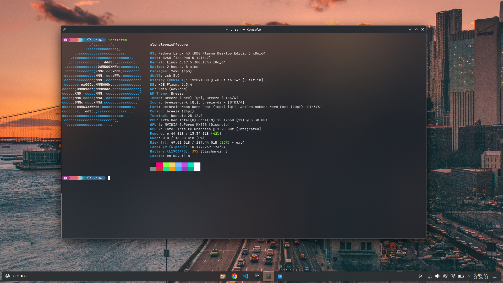

# My Simple Workspace Dotfiles

This config is include:

- [VS Code](https://code.visualstudio.com/) config
- [NeoVim](https://neovim.io/) config using [NVChad](https://nvchad.com/)
- ZSH as shell using [Oh My Zsh](https://ohmyz.sh/) and [Starship](https://starship.rs/)
- My Fonts
- My Wallpaper
- [Obsidian](https://obsidian.md/), [OnlyOffice](https://www.onlyoffice.com/), and [Zotero](https://www.zotero.org/) via `setup/setup-additional-apps.sh`
- KDE Plasma panel, shortcuts, KWin/Krohnkite, launcher and theme via `setup/setup-kde.sh`

### KDE config

KDE live config files are kept as **regular files**, not symlinks into this repo. Storing Plasma/KWin config as stow symlinks caused wallpaper and activity state to break, so this repo keeps sanitized templates in `setup/kde/` and merges them into `~/.config/` with `kwriteconfig6`.

- `setup/setup-kde.sh` installs Krohnkite and nokara, then restores the config. Use `--config-only` to skip plugin installation.
- The panel/widget layout is installed only when missing; all other keys are merged and existing changes are kept.
- `setup/export-kde-config.sh` refreshes the templates from the current live config after changing things in KDE settings.
- Wallpaper, current activity, screen mapping and geometry are intentionally not versioned.
- Re-login after restoring so KWin and global shortcuts reload.

### Others Consideration Tools

- I am currently using KDE Plasma as my desktop environtment but the config i mentioned should work on all DE.
- I am using additional plugin for for ZSH which is: autosuggesions and zsh-fast-syntax-highlighting as mentioned in [this](https://gist.github.com/n1snt/454b879b8f0b7995740ae04c5fb5b7df) gist page.
- I am using [FNM](https://github.com/Schniz/fnm) as node.js version manager
